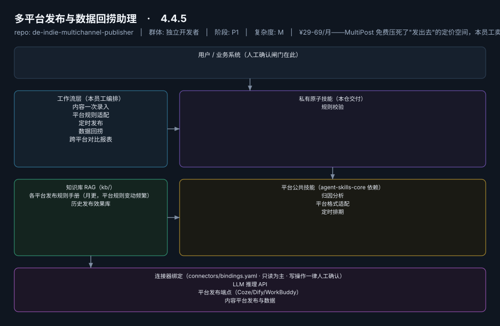

# 多平台发布与数据回捞助理

> 一次录入、十平台分发、数据自动回捞的"分发中控台"
>
> **4.4.5**　·　独立开发者　·　阶段 P1　·　
> 复杂度 M　·　¥29-69/月——MultiPost 免费压死了"发出去"的定价空间，本员工卖的是"数据回收 + AI 改写"增值闭环　·　定义卡 4.4.5



**一句话**：需要多平台内容分发的全体独立开发者与内容创作者

---

## 这个数字员工解决什么问题

一次录入、十平台分发、数据自动回捞的"分发中控台"

| 项 | 内容 |
|---|---|
| 服务对象 | 需要多平台内容分发的全体独立开发者与内容创作者 |
| 可量化目标 | 单篇内容分发平台数 ≥8；分发耗时 ≤10 分钟/篇；数据回捞覆盖率 ≥90% |
| 投入产出 | 日更用户月省约 20h ≈ ¥1600 |
| 需求依据 | D11、D19 |
| 分发渠道 | GitHub、小红书、闲鱼、淘宝 |

## 30 秒上手

```bash
git clone <本仓库地址> && cd de-indie-multichannel-publisher
pip install pyyaml
python3 tests/run.py            # 先跑一遍自检，确认环境与契约都对得上
```

试用（把 `<输入>` 换成本人真实材料）：

```text
请以「多平台发布与数据回捞助理」的身份，帮我跑「内容一次录入」。
材料如下：<输入>
要求：只使用材料里出现过的数字，缺的写 <待填>；对外文案停在待确认状态。
```

详细接入见 [`docs/01-安装与接入.md`](docs/01-安装与接入.md)。

## 仓库结构

```text
de-indie-multichannel-publisher/
├── employee.yaml          # 机器契约（能力清单 + 依赖锁）
├── dependencies.yaml      # 对 core 的外部依赖（含版本）
├── persona/               # 运行提示词 / 边界 / KPI
├── skills/                # 私有原子技能（1 个）
├── spec-bindings/         # 有意不公共化能力的本地绑定声明（1 个）
├── workflows/             # 本员工工作流（5 条）
├── kb/                    # 知识库 RAG 契约
├── connectors/            # 连接器绑定（只读为主，写操作人工确认）
├── docs/                  # 六类发布文档
└── tests/                 # 自动化多场景测试
```

## 私有原子技能（1）

| 技能 | slug | 复杂度 | 阶段 | 成熟度 |
|---|---|---|---|---|
| `规则校验` | `rule-validation` | S | P1 | 契约完备 |

## 平台公共技能依赖（3）

| 技能 | slug | 全平台复用员工数 |
|---|---|---|
| `归因分析` | `attribution-analysis` | 4 |
| `平台格式适配` | `platform-format-adapter` | 6 |
| `定时排期` | `scheduled-dispatch` | 6 |

> 这些技能来自 `agent-skills-core@1.0.0`，本仓库**只引用不复制**。

## Spec 绑定层（1）

| 能力 | slug | 契约位置 | 本仓落点 |
|---|---|---|---|
| `数据对接` | `data-ingest-adapter` | `agent-skills-core/specs/data-ingest-adapter.md` | `spec-bindings/data-ingest-adapter.md` |

> 这一族能力**有意不公共化**（与外部平台接口强绑定）。本仓不存正文，
> 只留本地绑定声明与连接器配置。

## 工作流（5）

| 工作流 | slug | 触发 | 阶段 | 调用技能数 |
|---|---|---|---|---|
| `内容一次录入` | `wf-indie-publisher-intake` | 人工 | P1 | 1 |
| `平台规则适配` | `wf-indie-publisher-dispatch` | 事件（录入后） | P1 | 2 |
| `定时发布` | `wf-indie-publisher-schedule` | 定时 | P1 | 1 |
| `数据回捞` | `wf-indie-publisher-retrieve` | 定时（T+1/T+7） | P1 | 1 |
| `跨平台对比报表` | `wf-indie-publisher-report` | 定时（每周） | P2 | 1 |

## 知识库与连接器

- 知识库语料：['各平台发布规则手册（月更，平台规则变动频繁）', '历史发布效果库']
- 连接器：LLM 推理 API、平台发布端点（Coze/Dify/WorkBuddy）、内容平台发布与数据

## 质量与验收

| 项 | 值 |
|---|---|
| 技能文件数 | 66 |
| 多场景用例数 | 182 |
| 用例通过 | 182 |
| 验收结论 | ✅ 通过 |

完整报告：[`docs/05-验收与测试.md`](docs/05-验收与测试.md)

## 许可

专有许可，详见 [`LICENSE`](LICENSE)。
