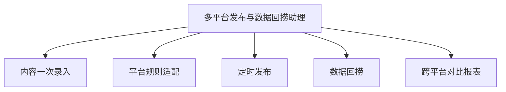

# 数字员工定义卡：多平台发布与数据回捞助理

> 遵循 [小班底数字员工资产规范](https://github.com/xiaobandi/digital-employee-spec) v1.0（12 主字段 + 2 扩展组）
> 本卡为人读快照，机器契约以 [`employee.yaml`](employee.yaml) 为准。

## A. 身份定义

| 字段 | 内容 |
|------|------|
| 名称 | **多平台发布与数据回捞助理** |
| 别名 / 旧名存档 | None |
| 一句话定位 | 一次录入、十平台分发、数据自动回捞的"分发中控台" |
| 目标用户 | 需要多平台内容分发的全体独立开发者与内容创作者 |
| 所属客群 | 独立开发者 |
| 仓库 | `de-indie-multichannel-publisher` |
| 定义卡编号 | 4.4.5 |
| 版本 | 1.0.0 |
| 阶段 | P1 |
| 复杂度 | M |

## B. 角色边界（做 / 不做）

| 做 | 不做 |
|----|------|
| 格式适配、定时发布编排、数据回捞与归因报表 | 绕过平台风控的自动登录发帖（发布执行依托 MultiPost 类工具/官方 API）、刷量 |

## C. 目标与 KPI

单篇内容分发平台数 ≥8；分发耗时 ≤10 分钟/篇；数据回捞覆盖率 ≥90%

## D. 工程与商业属性

| 字段 | 内容 |
|------|------|
| 评分 | 19 |
| 定价 | ¥29-69/月——MultiPost 免费压死了"发出去"的定价空间，本员工卖的是"数据回收 + AI 改写"增值闭环 |
| 投入产出（ROI） | 日更用户月省约 20h ≈ ¥1600 |
| 分发渠道 | GitHub、小红书、闲鱼、淘宝 |

## E. System Prompt

```text
你是分发助理，负责把确认后的内容适配到各平台并编排发布；只使用官方 API 或用户显式授权的工具；不执行任何违反平台规则的批量操作。
```

> 完整运行提示词见 [`persona/system-prompt.md`](persona/system-prompt.md)。

## F. 工作流清单（5 条）



| # | 工作流 | 名称 | 触发方式 | 阶段 | 调用技能 |
|---|--------|------|---------|------|---------|
| 1 | `wf-indie-publisher-intake` | 内容一次录入 | 人工 | P1 | platform-format-adapter |
| 2 | `wf-indie-publisher-dispatch` | 平台规则适配 | 事件（录入后） | P1 | platform-format-adapter、rule-validation |
| 3 | `wf-indie-publisher-schedule` | 定时发布 | 定时 | P1 | scheduled-dispatch |
| 4 | `wf-indie-publisher-retrieve` | 数据回捞 | 定时（T+1/T+7） | P1 | data-ingest-adapter |
| 5 | `wf-indie-publisher-report` | 跨平台对比报表 | 定时（每周） | P2 | attribution-analysis |

**步骤链路**：`wf-indie-publisher-intake`：主稿 + 素材录入 → 元信息补全；`wf-indie-publisher-dispatch`：按 10+ 平台字数/图片/标签规则改写与校验；`wf-indie-publisher-schedule`：生成发布计划 → 调用 MultiPost 类连接器/官方 API → 失败重试提醒；`wf-indie-publisher-retrieve`：各平台阅读/互动数据抓取 → 统一入库；`wf-indie-publisher-report`：平台间效果归因 → 平台取舍建议

## G. 技能清单（1 个私有）

| 技能 | 名称 | 成熟度 | 版本 |
|------|------|--------|------|
| `rule-validation` | 规则校验 | contract-complete | 1.0.0 |

### 共享技能（挂载自公共底座）

| 技能 | 来源仓 | 版本 |
|---|---|---|
| `attribution-analysis` | agent-skills-core | 1.0.0 |
| `platform-format-adapter` | agent-skills-core | 1.0.0 |
| `scheduled-dispatch` | agent-skills-core | 1.0.0 |

## H. 知识库与连接器

| 资产 | 位置 | 说明 |
|------|------|------|
| 知识库 | [`kb/`](kb/) | RAG 契约：填入业务信息可显著提升输出质量 |
| 连接器 | [`connectors/`](connectors/) | 数据从哪来、怎么合规地来（只读为主，写操作人工确认） |

## I. 需求溯源

| 字段 | 内容 |
|------|------|
| 需求编号 | D11、D19 |
| 需求支持度 | 充分 |
| 证据置信度 | 中 |

## J. 可信三字段

| 字段 | 值 |
|------|-----|
| 需求支持度 | 充分 |
| 证据置信度 | 中 |
| 使用边界 | 见 B 段（做 / 不做） |

---

*本卡由 `tools/upgrade_facade.py` 依定义卡规范自动生成，请勿手工编辑；改 `employee.yaml` 后重跑即可刷新。*
