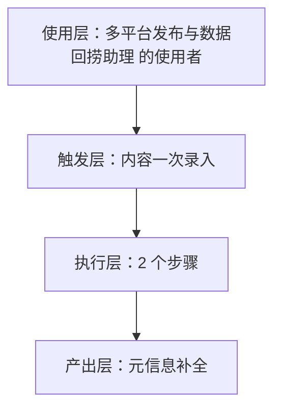
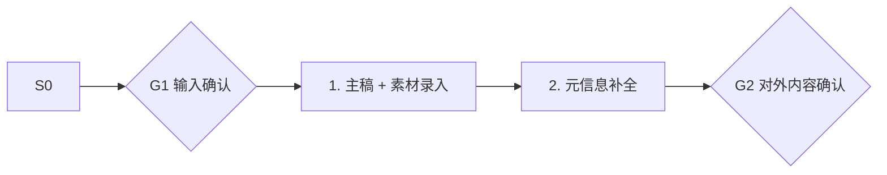

# 内容一次录入 · 架构与流程图

## 本工作流的四层结构

| 层 | 内容 |
|---|---|
| 使用层 | 需要多平台内容分发的全体独立开发者与内容创作者；员工定位：一次录入、十平台分发、数据自动回捞的"分发中控台" |
| 触发层 | 关键词 / 显式点名「内容一次录入」；触发方式：人工 |
| 执行层 | 主稿 + 素材录入 → 元信息补全 |
| 产出层 | 元信息补全 |

## 执行流程

## 步骤职责表

| # | 步骤 | 承担者 | 为什么 |
|---|---|---|---|
| 1 | 主稿 + 素材录入 | 模型 | 需要读懂语境，不可用固定规则替代 |
| 2 | 元信息补全 | 模型 | 需要读懂语境，不可用固定规则替代 |

⚠️ 尚未补齐：图中的步骤来自注册表口径，未逐条实跑校验；实跑后请同步修订本页（`发布标准.md` 第六项：通读一遍，不得出现重复填充句）。
